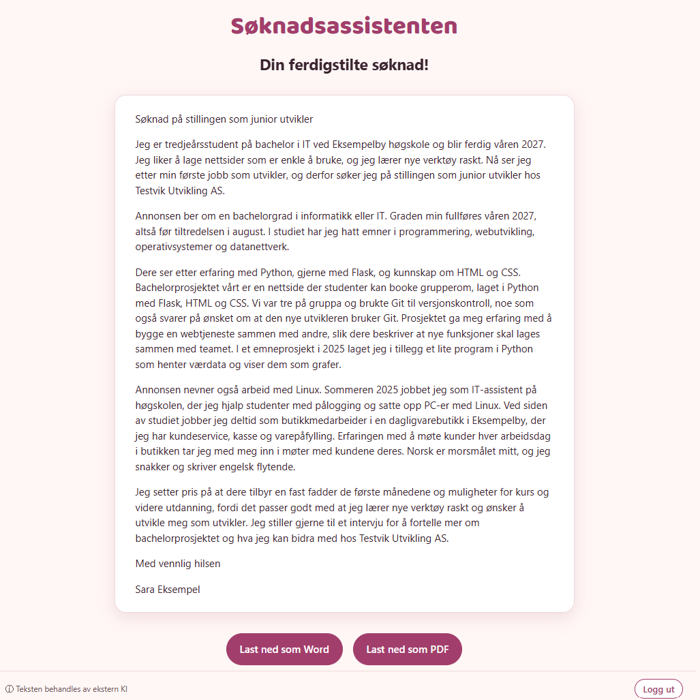

# G68 — Grande

Gruppeprosjekt i **IBE160 Programmering med KI** ved Høgskolen i Molde, høsten 2026 (15 studiepoeng).

Repoet inneholder gruppens applikasjon og dokumentasjon av utvikling, testing og kvalitetssikring med KI.

## Medlemmer

- Kristine Rosland Grande

## Søknadsassistenten

> **Status:** Planleggingen er ferdig (brief, PRD, UX, konkurrentanalyse, arkitektur, epics og stories, og sprint planning). Nettsiden er ferdig. I testmodus virker innlogging og registrering, startsiden, modusvalget, innleggingen av CV og annonse, ventetegnet, resultatsiden med gap-analyse og nøkkelordtreff, søknadsbrevet, nedlastingen som Word og PDF og vinduet etter nedlasting, «Nytt forslag» til brevet, Korrektur av eget brev med markerte endringer, og opplasting av CV, brev og annonse som PDF med feilmeldinger for filer som ikke kan brukes. Er bare CV-en endret, brukes den samme nøkkelordlisten igjen. Pynten er på plass (fyrverkeri på brevsiden, prosentlinjen som fylles og ikonet som vipper på modusvalget), «Logg ut» spør først når brevet ikke er lastet ned, og filnavnet har arbeidsgiveren i seg. Med API-nøkkel kan testmodus slås av, og da brukes ekte KI (Claude).

Søknadsassistenten er en nettside som hjelper studenter med å skrive et søknadsbrev som er skreddersydd til én konkret stilling. Brukeren legger inn CV-en sin og en stillingsannonse, og velger om KI-en skal skrive brevet fra bunnen av (**Full generering**) eller forbedre et brev brukeren har skrevet selv (**Korrektur**). Før brevet skrives, viser nettsiden hvilke krav i annonsen CV-en dekker og mangler (**gap-analyse**), og hvor mange av annonsens nøkkelord som står i CV-en (**nøkkelordtreff**, for eksempel «7 av 10 = 70 %»). Brevet kan lastes ned som Word eller PDF.

**Hvem den er for:** studenter og nyutdannede som søker jobb eller praksisplass for første gang, og som mangler erfaring med hva som fungerer i en søknad. Nettsiden er åpen for alle jobbsøkere, men forklaringene er laget for studenter.

**Hva er med, og hva er kuttet:** Alt som er planlagt for versjon 1 i [PRD-en](my-project/2-prd/prd.md), er laget. Det gjelder også alle funksjonene på nødlisten, som kunne vært kuttet hvis tiden ble knapp. Det som bevisst er utelatt fra versjon 1, for eksempel engelsk, lagring mellom øktene og redigering av brevet i nettleseren, står med begrunnelse i kuttlisten i PRD-en (del 4).

## Skjermbilder

Skjermbildene er tatt med ekte KI (testmodus av) og de fiktive testdataene i case 1 (`backend/testdata/case-1-utvikler/`). Nede til venstre står «Teksten behandles av ekstern KI». Ekte KI kan gi en litt annen nøkkelordliste enn fasiten, så prosenten på resultatsiden er 47 % her, mens testmodus gir 50 %.

**Resultatsiden** med gap-analyse og nøkkelordtreff:


**Brevsiden** i Full generering:



**Korrektur** med markerte endringer:


## Installasjon og oppstart

**Forutsetninger:** [uv](https://docs.astral.sh/uv/) versjon 0.12 eller nyere. uv henter selv riktig Python (3.14, låst i `backend/.python-version`, minst 3.12) og alle pakkene. Du trenger ikke installere Python først.

**1. Hent koden** (bare første gang). Velg én av måtene:

- **Med Git:** skriv dette i terminalen. Det laster ned hele repoet til en ny mappe `G68-grande` og går inn i den:

  ```bash
  git clone https://github.com/IBE160-2026/G68-grande.git
  cd G68-grande
  ```

- **Uten Git:** trykk den grønne knappen «Code» på GitHub-siden til repoet og velg «Download ZIP». Pakk ut ZIP-fila, og åpne terminalen i mappen som kommer ut (`G68-grande-main`). På Windows kan du høyreklikke i mappen og velge «Åpne i Terminal».

**2. Installer uv** (bare første gang):

- Windows (PowerShell):

  ```powershell
  powershell -ExecutionPolicy ByPass -c "irm https://astral.sh/uv/install.ps1 | iex"
  ```

- Mac og Linux:

  ```bash
  curl -LsSf https://astral.sh/uv/install.sh | sh
  ```

Lukk og åpne terminalen igjen etterpå, så kommandoen `uv` blir funnet.

**3. Start nettsiden** fra mappen fra steg 1 (`G68-grande` eller `G68-grande-main`):

```bash
cd backend
uv sync
uv run flask --app soknad run
```

Åpne så <http://127.0.0.1:5000> i nettleseren. Stopp nettsiden med `Ctrl+C` i terminalen. Er port 5000 opptatt (ofte på Mac), starter du med `uv run flask --app soknad run --port 5001` og åpner <http://127.0.0.1:5001>.

**Innstillinger (valgfritt):** nettsiden starter uten noe oppsett. Vil du endre innstillingene, kopierer du `backend/.env.example` til `backend/.env` og fyller inn verdiene der. `.env` havner aldri i Git.

| Innstilling | Hva den gjør | Hvis den er tom |
| --- | --- | --- |
| `ANTHROPIC_API_KEY` | Nøkkel til Claude API. Med nøkkel kan testmodus slås av | Nettsiden kjører i testmodus |
| `ANTHROPIC_MODEL` | Hvilken Claude-modell som brukes | `claude-opus-5-5` |
| `SECRET_KEY` | Signerer innloggingen | En tilfeldig nøkkel lages ved hver oppstart |

**Testbruker:** logg inn med e-post `test@example.com` og passord `testpassord1`. Du trenger ikke registrere deg. Databasen (`backend/instance/brukere.db`) og testbrukeren lages automatisk første gang nettsiden starter. Vil du begynne på nytt med en tom database, stopper du nettsiden og sletter mappen `backend/instance/`. Innloggingen huskes bare i minnet, så når nettsiden startes på nytt, er alle logget ut og må logge inn igjen. Nettsiden kan kjøres i testmodus uten API-nøkkel.

**Testmodus og samtykke:** uten API-nøkkel er bryteren «Testmodus» oppe til høyre på startsiden låst på, og under den står «Mangler API-nøkkel, se README». Nettsiden bruker da de ferdige svarene i `backend/testdata/`, og ingenting sendes til ekstern KI. Med API-nøkkel i `backend/.env` er testmodus av når du logger inn, og bryteren kan slås av og på, men bare på startsiden. Når testmodus er av, sendes CV-en og annonsen til Claude, og du må krysse av for «Jeg samtykker til bruk av KI» før «Begynn å lage søknad» virker. Avkrysningen må gjøres hver gang du kommer til startsiden. «i»-knappen ved siden av forklarer hva samtykket betyr. Nede til venstre står «Teksten behandles av ekstern KI» så lenge testmodus er av. Hvert kall til Claude koster litt (se `ANTHROPIC_MODEL` over). Nøkkelen leses bare når nettsiden starter, så du må starte nettsiden på nytt etter at du har endret `.env`. Er nøkkelen ugyldig, gir hvert KI-kall «Noe gikk galt hos KI-tjenesten. Prøv på nytt.». Rett da nøkkelen, eller slå på testmodus.

## Slik bruker du nettsiden

Hele flyten i testmodus med de fiktive testdataene. Den virker uten API-nøkkel. Alt testmaterialet ligger i `backend/testdata/`:

| | Case 1: junior utvikler | Case 2: junior økonomimedarbeider |
| --- | --- | --- |
| CV | [cv.txt](backend/testdata/case-1-utvikler/cv.txt) · [cv.pdf](backend/testdata/case-1-utvikler/cv.pdf) | [cv.txt](backend/testdata/case-2-okonomi/cv.txt) · [cv.pdf](backend/testdata/case-2-okonomi/cv.pdf) |
| Stillingsannonse | [annonse.txt](backend/testdata/case-1-utvikler/annonse.txt) · [annonse.pdf](backend/testdata/case-1-utvikler/annonse.pdf) | [annonse.txt](backend/testdata/case-2-okonomi/annonse.txt) · [annonse.pdf](backend/testdata/case-2-okonomi/annonse.pdf) |
| Eget søknadsbrev (Korrektur) | [eget-brev.txt](backend/testdata/case-1-utvikler/eget-brev.txt) · [eget-brev.pdf](backend/testdata/case-1-utvikler/eget-brev.pdf) | – |
| Fasit (prosenten og kravene) | [fasit.md](backend/testdata/case-1-utvikler/fasit.md) | [fasit.md](backend/testdata/case-2-okonomi/fasit.md) |

Filer som gir feilmeldinger: [skannet.pdf](backend/testdata/feil/skannet.pdf) og [feil-type.docx](backend/testdata/feil/feil-type.docx) i [`backend/testdata/feil/`](backend/testdata/feil/).

1. **Logg inn** med testbrukeren (`test@example.com` og `testpassord1`). Startsiden «Velkommen! 👋» sier at du er i testmodus.
2. Trykk **«Begynn å lage søknad»**, og velg kortet **«Full generering»** på siden «Hva vil du gjøre i dag?».
3. På innleggingen trykker du «Lim inn tekst» i feltet «CV» og limer inn hele `cv.txt` fra case 1. Gjør det samme med `annonse.txt` i feltet «Stillingsannonse». Du kan også trykke «Last opp PDF» og velge `cv.pdf` og `annonse.pdf`. Trykk **«Sjekk CV-en min»**.
4. **Resultatsiden** «Slik passer CV-en din til stillingen» viser gap-analysen: hva CV-en dekker, og hva som kan jobbes videre med. Nøkkelordtreffet skal vise **10 av 20 = 50 %**, som i `fasit.md`.
5. Trykk **«Lag søknadsbrevet mitt»**. Brevsiden «Din ferdigstilte søknad!» viser brevet. «Nytt forslag» gir et annet brev.
6. Trykk **«Last ned som Word»** eller **«Last ned som PDF»**. Fila lastes ned, og vinduet «Brevet er lastet ned!» spør om du vil lage en ny søknad eller logge ut.
7. **Korrektur:** trykk «Lag ny søknad», så «Begynn å lage søknad» og kortet **«Korrektur»**. Lim inn `cv.txt`, `eget-brev.txt` i feltet «Ditt søknadsbrev» og `annonse.txt`, alle fra case 1. Trykk «Sjekk CV-en min» og så **«Oppdater søknadsbrevet mitt»**. Brevsiden viser de endrede setningene i grønt, og trykker du på en av dem, ser du under «Du skrev» det brukeren skrev.
8. **Feil input:** trykk «Sjekk CV-en min» med tomme felt, eller last opp filene i `backend/testdata/feil/`. Da kommer feilmeldingene øverst på siden. Flere feilmeldinger står under «Testdata og tester».

Case 2 kan brukes i Full generering på samme måte. Prosenten står i fasiten for case 2. Med API-nøkkel kan testmodus slås av på startsiden, og da lager Claude analysen og brevet (se «Testmodus og samtykke» over).

## Testdata og tester

De automatiske testene og kodesjekken kjøres fra `backend/`:

```bash
cd backend
uv run pytest
uv run ruff check
uv run ruff format --check
```

`uv run pytest` kjører alle testene. `uv run ruff check` sjekker koden, blant annet at alle filer åpnes med en oppgitt `encoding` (vi bruker alltid utf-8), og `uv run ruff format --check` sjekker formateringen. De samme sjekkene kjører automatisk på GitHub (fanen «Actions») på både Linux og Windows ved hver PR.

**Testdata og fasit:** de fiktive testdataene ligger i `backend/testdata/`, med én mappe per testcase: `case-1-utvikler/` (en IT-student som søker som junior utvikler) og `case-2-okonomi/` (en økonomistudent som søker som junior økonomimedarbeider i et regnskapsbyrå). Hver mappe har en CV (`cv.txt`) og en stillingsannonse (`annonse.txt`) som kan limes inn på innleggingssiden i testmodus, og fasiten ligger i `fasit.md` i samme mappe. Mappen `ki-svar/` har ekte KI-svar fra Claude, slik at nettsiden kan kjøres i testmodus uten API-nøkkel og likevel viser hvordan den virker med ekte KI. Fasiten viser hvilke krav CV-en dekker og mangler, hvilke nøkkelord som er viktige, og nøyaktig hvilken prosent nøkkelordtreffet skal gi. Alle personer, firmaer og skoler i testdataene er oppdiktet. CV-en og annonsen må være fra samme mappe. CV-en fra én mappe og annonsen fra en annen gir «Stillingsannonse: I testmodus må CV-en og annonsen være fra samme mappe i backend/testdata/.». Begge casene er for Full generering. Korrektur testes bare med case 1: der ligger også et fiktivt søknadsbrev som Sara har skrevet selv (`case-1-utvikler/eget-brev.txt`), og det limes inn i feltet «Ditt søknadsbrev» sammen med CV-en og annonsen fra samme mappe. Fasiten for Korrektur står under «Sjekkliste for Korrektur» i `fasit.md`. Et annet brev, eller CV og annonse fra case 2 i Korrektur, gir «Ditt søknadsbrev: I testmodus fungerer bare testdataene fra mappen backend/testdata/.». Mangler `backend/testdata/`, en case-mappe, `cv.txt` eller `annonse.txt`, eller har to caser samme CV, annonse eller eget brev, starter ikke nettsiden, og feilmeldingen sier hva som er galt. `eget-brev.txt` er valgfri, og bare case 1 har en. Mangler en fil i `ki-svar/`, starter nettsiden, men steget som trenger fila, gir «Noe gikk galt hos KI-tjenesten».

**PDF-ene i testdataene:** hver `.txt` i testdataene har også en PDF med samme tekst, lagret fra Word: `cv.pdf` og `annonse.pdf` i begge mappene, og `eget-brev.pdf` i case 1. På innleggingssiden kan du trykke «Last opp PDF» i stedet for «Lim inn tekst», og i testmodus gir PDF-en samme testcase og samme nøkkelordtreff som `.txt`-fila (kriterium 5, testet i `backend/tests/test_testdata.py`). PDF-ene lages med skriptet `backend/scripts/lag_testpdf.ps1`, som trenger Microsoft Word på Windows. Det åpner hver `.txt` i Word og lagrer den som PDF ved siden av. Kjør det på nytt når en `.txt`-fil i testdataene endres:

```powershell
cd backend
powershell -ExecutionPolicy Bypass -File scripts\lag_testpdf.ps1
```

**Filer som gir feil:** mappen `backend/testdata/feil/` har to filer til å prøve feilmeldingene på innleggingssiden. Den er ikke et testcase. `skannet.pdf` er CV-en fra case 1 som et bilde uten tekst, som en skannet CV, og gir «CV: Vi klarer ikke å lese teksten i PDF-en. Den kan være skannet. Lim inn teksten i stedet.». `feil-type.docx` er den samme CV-en som Word-fil og gir «CV: Feil filtype, prøv PDF.» (velg «Alle filer» i filvelgeren for å se den). En fil over 5 MB gir «CV: Filen er for stor. Den kan være på høyst 5 MB.», og er alle filene til sammen over 16 MB, står «Filene er for store. Hver fil kan være på høyst 5 MB.» øverst på siden. I de andre feltene står feltnavnet først i stedet for «CV». En PDF regnes som uleselig når den har under 50 bokstaver. Grensene står i `backend/soknad/innstillinger.py`. Filene lages med skriptet `backend/scripts/lag_feilfiler.ps1`, som også trenger Microsoft Word på Windows:

```powershell
cd backend
powershell -ExecutionPolicy Bypass -File scripts\lag_feilfiler.ps1
```

**Lage testsvarene på nytt:** svarene i `ki-svar/` lages med skriptet `backend/scripts/lag_testsvar.py`, og bare med det. Skriptet trenger API-nøkkelen i `backend/.env`, sender CV-en og annonsen i hvert testcase til Claude og skriver `nokkelord.json`, `gap.json`, `brev-1.json` og `brev-2.json`. Har testcaset et eget brev (`eget-brev.txt`, bare case 1), sendes det også, og skriptet skriver i tillegg `korrektur-1.json` og `korrektur-2.json` (det forbedrede brevet i Korrektur). Feiler et KI-kall, skrives ingenting for det testcaset. Med `--ut` skrives svarene i en annen mappe, og `ki-svar/` er uendret:

```bash
cd backend
uv run python -m scripts.lag_testsvar
uv run python -m scripts.lag_testsvar --ut ../my-project/testkjoringer/<story>/kjoring-<n>
uv run python -m scripts.lag_testsvar --case case-2-okonomi
uv run python -m scripts.lag_testsvar --testdata ../my-project/testkjoringer/4-5/inndata --ut ../my-project/testkjoringer/<story>/kjoring-<n>
uv run python -m scripts.lag_testsvar --case case-1-utvikler --bare-korrektur
```

Med `--case` kjøres bare ett testcase. Med `--testdata` leses testcasene fra en annen mappe. Det brukes for kriterium 3, der CV-en fra case 1 kjøres mot annonsen fra case 2 (`my-project/testkjoringer/4-5/inndata/`). Med `--bare-korrektur` lages bare `korrektur-1.json` og `korrektur-2.json` (to KI-kall per testcase med eget brev), så de sjekkede brev-, gap- og nøkkelordsvarene ikke lages på nytt. Testcaser uten `eget-brev.txt` hoppes da over.

En kjøring tar omtrent ett minutt per testcase og kostet ca. 1,2–1,8 kr per testcase 14. november 2026. De to Korrektur-svarene i case 1 tar i tillegg ca. 45 sekunder og kostet ca. 1,7 kr 15. november 2026. Tokens og anslått pris for hvert kall står i terminalen. Feiler et testcase, kjøres de andre likevel, og skriptet ender med feilkode 1 (2 når API-nøkkelen mangler, 3 når testcaset i `--case` ikke finnes, når mappen ikke har noen testcaser, eller når ingen av testcasene har `eget-brev.txt` med `--bare-korrektur`). Etter en ny kjøring oppdateres tabellen «Nøkkelord» og prosenten i `fasit.md`, ellers feiler testene. Testene sjekker også brevene: ingen av de 17 typiske KI-frasene, og ingenting fra sjekklisten i `fasit.md`. Feiler de, er det plan B i testplanen. Resultatet av kjøringene mot fasiten står i [testplanen](my-project/testplan.md).

## Kjente begrensninger

Disse er bestemt i [PRD-en](my-project/2-prd/prd.md), eller funnet mens nettsiden ble laget.

- **Nøkkelordtreffet er bare en ordtelling** og en pekepinn på hvordan et ATS kan vurdere CV-en, ikke en garanti.
- **Bøyningsformer fanges ikke opp:** «prosjektledelse» er ikke et treff i «prosjektleder».
- **Et nøkkelord kan gi treff inne i et annet ord:** «Java» er et treff i «JavaScript». Korte nøkkelord på 1–3 tegn må stå som eget ord, men «C» kan likevel gi feil treff i en liste nummerert med bokstaver, og «C» gir også treff i «C#» og «C++». Motsatt gir korte nøkkelord (1–3 tegn) ikke treff inne i lengre ord, for eksempel «SQL» i «MySQL» og «PostgreSQL».
- **Gap-analysen og nøkkelordtreffet kan si hverandre imot,** fordi gap-analysen er en vurdering KI-en gjør, mens nøkkelordtreffet bare teller ord.
- **Koden sjekker ikke at brevet fra Claude følger reglene i prompten** (250–400 ord, 4–6 avsnitt, ingen typiske KI-fraser og ingenting som ikke står i CV-en, se `backend/prompts/brev.md`). Reglene ble prøvd med ekte KI i tre kjøringer per testcase mot sjekklisten i fasiten (kriterium 11 i [testplanen](my-project/testplan.md)), og testsvarene i `backend/testdata/` sjekkes automatisk for de typiske KI-frasene, men et brev fra ekte KI sjekkes ikke hver gang.
- **I testmodus virker bare de fiktive testdataene i `backend/testdata/`,** og CV-en og annonsen må være fra samme testcase. I Korrektur virker bare brevet i case 1.
- **PDF fra Canva og lignende programmer kan gi teksten i feil rekkefølge.** PDF lagret fra Word leses best, også med to kolonner eller en tabell (tabellprøven i `my-project/testplan.md`). Fra Canva kommer all teksten, men overskriftene kan havne på feil sted. Lim da heller inn teksten. En skannet PDF (bare et bilde) kan ikke leses.
- **Grenser mot høy kostnad:** CV-feltet og annonsefeltet godtar høyst 15 000 tegn hver, og brevfeltet i Korrektur høyst 5 000 tegn (et langt brev gjør svaret fra KI-en for stort og tregt, se retro 5 i `my-project/testplan.md`). Med ekte KI kan hver søknad bruke høyst 10 KI-kall (en analyse er 2 kall, et brev 1, også «Prøv på nytt»). Deretter må du begynne på en ny søknad fra startsiden. I testmodus telles ingen kall. Grensen er en myk sperre mot mange trykk per søknad, og taket på 250 kr i Claude Console er den siste sperren. Grensene står i `backend/soknad/innstillinger.py`.
- **Et svar fra Claude om å vente kan gjøre at det tar lenge:** ber API-et om å vente før neste forsøk (`retry-after`), venter nettsiden så lenge før det ene nye forsøket, uten noen øvre grense. Det gjelder alle KI-kallene: «Sjekk CV-en min», «Lag søknadsbrevet mitt» og «Prøv på nytt».
- **Brevet kan slettes uten å spørre på tre måter:** går du «Tilbake» fra resultatsiden, endrer CV-en eller annonsen (eller brevet ditt i Korrektur) og trykker «Sjekk CV-en min», eller velger du et modus-kort på modusvalget (også det samme kortet), slettes brevet uten vinduet. Går du «Tilbake» helt til startsiden (fra innleggingen til modusvalget og så «Tilbake» der), begynner nettsiden på en ny søknad, og brevet er også borte. Vinduet kommer bare på brevsiden og resultatsiden. Last ned brevet før du går tilbake for å endre søknaden.
- **Arbeidsgiveren i filnavnet kan få den gamle skrivemåten:** retter du bare store og små bokstaver eller tegnsetting i annonsen (for eksempel «TELENOR ASA» til «Telenor ASA»), regnes annonsen som lik, og filnavnet får fortsatt `TELENOR-ASA`. Arbeidsgiveren følger nøkkelordlisten.
- **En dårlig nøkkelordliste kan ikke byttes ut uten å endre annonsen:** listen brukes igjen så lenge annonsen er lik (store og små bokstaver, mellomrom og tegnsetting teller ikke). Gir KI-en en dårlig liste, får du en ny bare ved å endre ordene i annonsen eller begynne på en ny søknad.
- **Ingenting lagres mellom øktene.** CV, annonse og brev forsvinner når brukeren logger ut, så brevet må lastes ned.
- **Det du har lagt inn, ligger i minnet til du logger ut.** Lukker du nettleseren uten å logge ut, blir CV-en, annonsen og brevet liggende i minnet på serveren til nettsiden stoppes.
- **Nettsiden har ingen CSRF-beskyttelse.** Skjemaene har ingen CSRF-token. Det går an fordi nettsiden bare kjører lokalt på egen PC, men CSRF-beskyttelse må legges til før nettsiden legges på nett. Innloggings-cookien har `SameSite=Lax` (satt i `backend/soknad/__init__.py`). Det stopper bare skjemaer (POST) fra andre nettsteder. Det stopper ikke lenker fra en annen nettside, og ikke andre sider som kjører på din egen PC (`localhost` eller `127.0.0.1`, også på en annen port). En slik lenke til `/last-ned/docx` kan for eksempel merke brevet som lastet ned, og da spør ikke «Logg ut» først. En vanlig lenke til `/` fra en annen nettside lager en ny søknad, og da er både det du har lagt inn og brevet borte.
- **Brevet skrives bare på norsk** i versjon 1.
- **Tegn som ikke finnes i skriften, vises ikke i PDF-fila.** PDF-en bruker skriften Noto Sans, som har æ, ø og å og vanlige tegn. Et tegn den ikke har (for eksempel emoji), gir ingen feil, men blir borte i PDF-en. I Word-fila er det med. KI-en skriver vanlig norsk tekst, så det skjer sjelden.
- **JavaScript-filene har ingen nettlesertester.** De automatiske testene sjekker HTML-en fra serveren og leser skriptene i `backend/soknad/web/static/js/` som tekst, men ingen test kjører dem i en nettleser. Det gjelder blant annet «Lim inn tekst» og søppelbøtta, «i»-boksene, ventetegnet, vinduene og den grønne knappen etter nedlasting. Hvert skript er prøvd for hånd i nettleseren, og tabellen «Skriptene som prøves for hånd» i [testplanen](my-project/testplan.md) viser hvor.

## Mappestruktur

```text
backend/                 Nettsiden (Python og Flask)
  soknad/
    web/                 Sidene: ruter, HTML-maler, tekstene på siden, CSS og JavaScript
    kjerne/              Reglene: telleregelen, stegene i flyten, sjekk av inndata og KI-svar
    adaptere/            Det som snakker med omverdenen: database, øktlager, KI, PDF inn, og Word- og PDF-fila
    fonts/               Skriften i PDF-fila (Noto Sans, 11 pt) med lisensen ved siden av (OFL.txt)
  prompts/               Promptene til Claude: nøkkelord, gap-analyse, brev og korrektur
  instance/              Databasen brukere.db, som lages ved første oppstart (ikke i Git)
  tests/                 De automatiske testene, delt på samme måte som soknad/
  testdata/              Fiktive CV-er, annonser og et eget brev (.txt og .pdf), med fasit og ekte KI-svar til testmodus, og feil/ med filer som gir feilmeldinger
  scripts/               lag_testsvar.py, som lager KI-svarene i testdata/ med ekte KI, lag_testpdf.ps1, som lager PDF-ene, og lag_feilfiler.ps1, som lager filene i feil/
  pyproject.toml, uv.lock  Pakkene og de låste versjonene, som uv sync bruker
  .env.example           Eksempel på innstillinger, uten ekte nøkler
my-project/              Alle plan- og prosessdokumentene (se oversikten der)
  testplan.md            Testplanen: resultatet av testene som gjøres for hånd og med ekte KI
  testkjoringer/         Svarene fra kjøringene med ekte KI, én mappe per story, retrospektiv eller retting
  skjermbilder/          Skjermbildene i denne README-en
.logs/kristine/          Sesjonslogger og åpne punkter
.github/workflows/       Automatiske sjekker (tester og ruff) på GitHub
_bmad/, .claude/         BMAD-oppsettet og skillene som KI-en bruker
```

Lagene er beskrevet i [arkitekturen](my-project/5-arkitektur/arkitektur.md): `web/` bruker `kjerne/` og `adaptere/`, og `kjerne/` bruker verken Flask, database eller filer.

## Plandokumenter

- [Product brief](my-project/1-product-brief/product-brief.md): hva Søknadsassistenten er, og hvem den er for
- [PRD](my-project/2-prd/prd.md): kravene til Søknadsassistenten, med nummererte krav (FR og NFR)
- [Addendum til PRD](my-project/2-prd/addendum.md): notater til UX og arkitektur fra PRD-arbeidet
- UX:
  - [DESIGN.md](my-project/3-ux/DESIGN.md): hvordan nettsiden ser ut, med farger, skrift, former, knapper og bevegelse
  - [EXPERIENCE.md](my-project/3-ux/EXPERIENCE.md): hvordan nettsiden virker, med sidene, tekstene, feilmeldingene, tilgjengelighet og brukerreisene
  - [Skisser](my-project/3-ux/skisser/): skisser av alle sidene på PC, nettbrett og mobil (åpnes i nettleseren)
- [Konkurrentanalyse](my-project/4-konkurrentanalyse/konkurrentanalyse.md): Jobscan, Rezi, Teal og Kickresume, sammenlignet med Søknadsassistenten
- [Arkitektur](my-project/5-arkitektur/arkitektur.md): de tekniske valgene (Python og Flask, Claude Opus 5.5, pypdf) og reglene koden skal følge
- [Epics og stories](my-project/6-epics-og-stories/epics.md): kravene delt opp i 8 epics og 31 stories med akseptansekriterier, i den rekkefølgen de skal kodes
- [Sprint-status](my-project/7-sprint-planning/sprint-status.yaml): status for hver story, oppdateres når en story blir ferdig

## Prosess og KI-bruk

- [Oversikt over alle dokumentene](my-project/README.md): hvert dokument med utkast, tilbakemeldinger, gjennomganger og beslutningslogger
- [Prompt-logg](my-project/prompt-logg.md): de viktigste forespørslene jeg har gitt KI-en underveis
- [Kort prompt-logg](my-project/prompt-logg-kort.md): de viktigste valgene mine og KI-feilene for hele prosjektet, på én side
- [Testplan](my-project/testplan.md): testene som gjøres for hånd og med ekte KI, med dato og resultat
- [Mine valg og KI-feil i UX](my-project/3-ux/mine-valg-og-ki-feil.md): hva jeg bestemte selv, og hvilke feil KI-en gjorde
- [Mine valg og KI-feil i arkitekturen](my-project/5-arkitektur/mine-valg-og-ki-feil.md): hva jeg bestemte selv, og hvilke feil gjennomgangen fant
- [Mine valg og KI-feil i epics og stories](my-project/6-epics-og-stories/mine-valg-og-ki-feil.md): hva jeg bestemte selv, og hvilke feil sjekkene fant
- [Koding](my-project/8-koding/): planen og kodegjennomgangen for hver story, med alle funn, hva som ble rettet og hvorfor resten ble avvist, og retrospektivene for [epic 1](my-project/8-koding/epic-1-retro-2026-11-08.md), [epic 2](my-project/8-koding/epic-2-retro-2026-11-10.md), [epic 3](my-project/8-koding/epic-3-retro-2026-11-12.md), [epic 4](my-project/8-koding/epic-4-retro-2026-11-14.md), [epic 5](my-project/8-koding/epic-5-retro-2026-11-15.md), [epic 6](my-project/8-koding/epic-6-retro-2026-11-17.md), [epic 7](my-project/8-koding/epic-7-retro-2026-11-21.md) og [epic 8](my-project/8-koding/epic-8-retro-2026-11-22.md). Koden for hver story ligger i en egen [pull request](https://github.com/IBE160-2026/G68-grande/pulls?q=is%3Apr), med hva KI-en gjorde feil
- [Sesjonslogger](.logs/kristine/README.md): hva som ble gjort i hver arbeidsøkt, med [åpne punkter](.logs/kristine/issues.md)
- [TO DO-liste](my-project/todo.md): hva som er gjort, og hva som gjenstår
