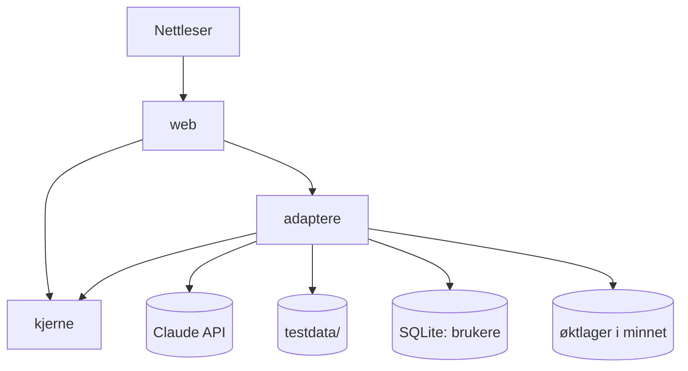
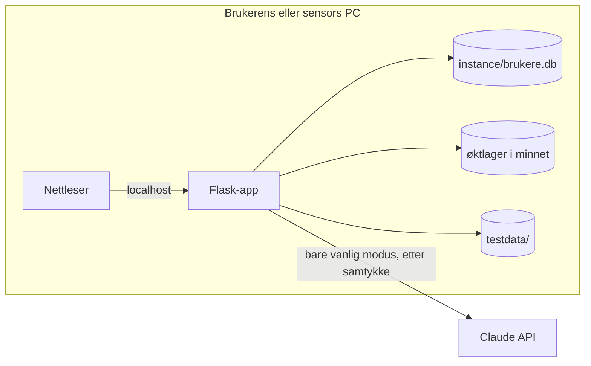

# Arkitektur — Søknadsassistenten

Dokumentet inneholder bare de tekniske beslutningene som må ligge fast før kodingen starter. Begrunnelsene står i beslutningsloggen (`.memlog.md`).

## Paradigme

**Lagdelt monolitt:** én Flask-app der serveren lager HTML-sidene. All kode ligger i `backend/`, fordi lærerens CI bare kjører Python-testene der. Mappene under er relative til `backend/`. Koden er delt i tre lag.

| Lag | Mappe | Inneholder |
| --- | --- | --- |
| Web | `soknad/web/` | Ruter, HTML-maler, brukertekster, innloggingssjekk |
| Kjerne | `soknad/kjerne/` | Regler uten I/O: økt- og stegmodell, telleregel, sjekk av inndata, kontroll av KI-svar, gjenkjenning av testdata, filnavn, feiltyper |
| Adaptere | `soknad/adaptere/` | KI (ekte og test), PDF inn, Word/PDF ut, database, øktlager |



## Regler (AD)

### AD-1 — Ett språk og ett rammeverk [ADOPTED]

- **Binds:** alle, NFR-8
- **Prevents:** at deler av nettsiden lages i ulike språk eller som en egen frontend-app.
- **Rule:** Python + Flask, og serveren lager sidene med Jinja-maler. JavaScript brukes i små, vanlige skript uten rammeverk og uten byggesteg, der siden må reagere uten å lastes på nytt. Eksempler er innleggingsfeltene, vinduer, «i»-boksen, ventetegnet, klikk på endret setning og fyrverkeri. Lista er ikke uttømmende. JavaScript endrer aldri søknadsdata. Det gjør bare serveren.

### AD-2 — Avhengighetene går mot kjernen

- **Binds:** alle, NFR-9
- **Prevents:** at reglene spres i rutene og ikke kan testes uten nettleser eller API-nøkkel.
- **Rule:** `kjerne/` importerer aldri `flask`, `anthropic`, `pypdf`, `docx`, `fpdf` eller `sqlite3`, og den leser aldri filer. Regler uten I/O ligger i `kjerne/`. `web/` kaller kjerne og adaptere. Adaptere bruker kjernens datatyper. Tester:
  - Kjernetester trenger verken nett, nøkkel eller filer.
  - Web- og adaptertester (FR-1, FR-3, FR-7, FR-30) bruker `create_app(test_config)` med en midlertidig SQLite-database, Flasks `test_client` og `TestKI`.

### AD-3 — KI er én stikkontakt med to utgaver

- **Binds:** FR-14–FR-16, FR-22–FR-25, FR-32–FR-34, FR-38
- **Prevents:** at testmodus og vanlig modus får ulik flyt, ulike signaturer eller ulike svarformer.
- **Rule:** `adaptere/ki.py` har ett grensesnitt med faste signaturer:
  - `nokkelord(annonse)`
  - `gap(cv, annonse)`
  - `brev(cv, annonse, forslag: int)`
  - `korrektur(cv, annonse, eget_brev, forslag: int)`

  Det finnes to utgaver:
  - **`EkteKI`** kaller Claude.
  - **`TestKI`** finner testcaset selv med `kjerne/testdata_match` og leser `testdata/<case>/ki-svar/`. Er `forslag` et oddetall, brukes `brev-1`/`korrektur-1`, og er det et partall, brukes `-2`.

  Begge sender svaret gjennom den samme `kjerne/ki_svar.kontroller()` og returnerer AD-4-formene eller kaster `KIFeil`. Web-laget velger utgave ut fra `Innlogging.testmodus` og vet ellers ikke hvilken som brukes.

### AD-4 — KI-svar har fast form og kontrolleres to ganger

- **Binds:** FR-14–FR-17, FR-22–FR-25, FR-28, FR-38, NFR-10
- **Prevents:** at ulike deler av koden tolker KI-svaret ulikt, eller at et tomt eller avkuttet svar vises.
- **Rule:** Hver KI-oppgave har én prompt-fil i `prompts/` og ett JSON-skjema som sendes med structured outputs (`output_config.format`).
  - **Skjemaene:** `additionalProperties: false`, og alle felt er påkrevd. Mangler en verdi, sendes `null`, så ingen felt er valgfrie.
  - **Formene:**

| Oppgave | Form |
| --- | --- |
| `nokkelord` | `{nokkelord: [str], arbeidsgiver: str \| null}` |
| `gap` | `{dekker: [str], mangler: [str]}` |
| `brev` | `{avsnitt: [str]}` |
| `korrektur` | `{setninger: [{ny: str \| null, gammel: [str], nytt_avsnitt: bool}]}` i brevets rekkefølge |

  - **Ubrukelig svar:** `kontroller()` gir `KIFeil(ubrukelig_svar)` når ett av disse gjelder:
    - `stop_reason` er noe annet enn `end_turn`
    - JSON-en er ugyldig
    - `nokkelord` er tom
    - både `dekker` og `mangler` er tomme
    - brevet er uten tekst (også når alle `ny` er `null`)
    - i Korrektur: alle `gammel`, satt sammen og vasket (AD-10), er ikke lik det opprinnelige brevet, også vasket
  - **Testsvar:** `testdata/<case>/ki-svar/*.json` inneholder bare objektet over. De lages av `scripts/lag_testsvar.py`, som kjører `EkteKI` på hvert testcase (FR-38).
  - **Grunn ved endring:** et felt `grunn` kan legges til i `korrektur` senere (står under «Gjøres hvis det blir tid»).

### AD-5 — Korrektur viser bare det KI-en sier

- **Binds:** FR-23, FR-25, FR-30
- **Prevents:** at visningen, markeringen og nedlastingen regner ut endringene hver på sin måte.
- **Rule:** En setning er:
  - **endret** når `gammel != [ny]`
  - **ny** når `gammel == []`
  - **fjernet** når `ny == null`

  Visningen sammenligner aldri tekst selv. Brevet som vises og lastes ned, er alle `ny` som ikke er null, satt sammen, med nytt avsnitt der `nytt_avsnitt` er sann, og uten markering. «Nytt forslag» sender alltid brukerens opprinnelige `eget_brev`.

  **Deling:** Korrektur-prompten sier at én setning aldri deles i to oppføringer. Blir en lang setning til to, står begge i samme `ny`. Slik betyr «ny» bare innhold som ikke fantes i brevet. Regelen kom fra prøven i chatten 7. november 2026: der ble andre halvdel av en delt setning vist som «(Ny setning)», selv om innholdet sto i brevet fra før.

### AD-6 — Telleregelen ligger ett sted

- **Binds:** FR-15–FR-17, FR-19
- **Prevents:** at prosenten regnes ulikt på ulike steder, at FR-17 tolkes ulikt, eller at nøkkelordlisten hentes på nytt.
- **Rule:** `kjerne/telleregel.py` er den eneste koden som avgjør treff og prosent.
  - **Store og små bokstaver:** både nøkkelord og CV sammenlignes med `casefold()`.
  - **4 tegn eller mer:** treff også som del av et lengre ord.
  - **1–3 tegn:** treff bare som eget ord, det vil si `(?<!\w)ord(?!\w)` med `re.escape`, slik at «C#» og «C++» virker. I Python regnes æ, ø og å som bokstaver.
  - **Telling:** hvert nøkkelord telles én gang.
  - **Prosent:** rundes med `Decimal(...).quantize(..., ROUND_HALF_UP)`. Pythons `round()` brukes ikke, fordi den runder 12,5 ned til 12.
  - **Tester:** 2 av 3 = 67 %, 1 av 8 = 13 %, «C» i «Center», «C#» og bindestrek («python-utvikler»).

### AD-7 — Øktdata i minnet, med fast form

- **Binds:** FR-15, FR-19, FR-25, FR-28, FR-31, FR-32, FR-36, NFR-4
- **Prevents:** at CV- eller brevtekst havner på disk eller i en cookie, at ulike stories lagrer søknaden med ulike feltnavn, eller at testmodus forsvinner med søknaden.
- **Rule:** `kjerne/okt.py` har to dataklasser, og koden bruker aldri løse strengnøkler.
  - **`Innlogging(bruker_id, testmodus)`** varer til brukeren logger ut.
  - **`Soknad`** varer én søknad. Den har disse feltene:
    - `steg`, `modus`, `samtykke`
    - `cv`, `annonse` og `eget_brev`, hver med `tekst` og `filnavn`
    - `nokkelord`, og den vaskede annonseteksten listen ble laget fra
    - `arbeidsgiver`, `gap`, `brev` eller `korrektur`
    - `forslag`, `lastet_ned`, `opptatt`

  Begge ligger i `adaptere/oktlager.py`, i minnet på serveren, nøklet på en tilfeldig økt-id. Den signerte Flask-cookien inneholder bare økt-id-en.
  - **Ny søknad:** å komme til startsiden lager alltid en ny `Soknad`. Da er samtykket tomt, men testmodus beholdes (UX).
  - **Utlogging:** sletter begge.
  - **Innlogging:** gir en ny økt-id.
  - **Gyldig cookie uten økt i minnet** (etter omstart): brukeren behandles som utlogget (FR-7).
  - **Ingen automatisk utlogging.**

### AD-8 — Serveren eier hvor i søknaden brukeren er

- **Binds:** FR-7, FR-9, FR-19, FR-21, FR-25, FR-27, FR-31, FR-32, FR-36
- **Prevents:** at tilbakeknappen, oppfriskning eller dobbeltklikk sender skjema på nytt, starter et nytt KI-kall, hopper over et steg eller lar gamle resultater stå.
- **Rule:** `kjerne/steg.py` eier stegene: start < modus < innlegging < resultat < brev.
  - **Vise en side:** en side kan vises når sidens steg ≤ `Soknad.steg`. Ellers sendes brukeren til siden for `Soknad.steg`. Alle sider unntatt innlogging og registrering krever `login_required`. Etter innlogging kommer man alltid til startsiden, og `next=` brukes ikke.
  - **Flytte steg:** `steg` flyttes bare etter en POST som har lyktes.
  - **Endre søknaden:** bare gjennom `sett_inndata`, `velg_modus` og `nytt_forslag` i kjernen. De nullstiller resultater som ikke lenger gjelder (brev, korrektur, `lastet_ned`). De beholder `nokkelord` bare når den vaskede annonseteksten er lik (FR-19).
  - **Testmodus-bryteren:** kan bare endres når `steg == start` (FR-32).
  - **Etter en POST:**
    - Lyktes den, sendes brukeren videre med redirect.
    - Feilet den (inndatafeil eller KI-feil), vises samme side på nytt uten redirect, med feilboks og det som allerede er lagret.
  - **KI-kall:** startes bare fra POST. `opptatt` settes rundt kallet. Kommer en ny POST mens `opptatt` er sann, sendes brukeren til siden for steget.
  - **Nedlasting:** `GET /last-ned/<docx|pdf>` lager filen, setter `lastet_ned` og sender filen.

### AD-9 — Feil har lukkede typer, og bare web-laget lager tekst

- **Binds:** FR-2–FR-4, FR-9–FR-12, FR-28, FR-34
- **Prevents:** at feil vises én om gangen, skrives ulikt på ulike sider, eller mangler en tekst.
- **Rule:** Typene ligger i `kjerne/feil.py` som lukkede lister.
  - **Inndatafeil returneres som en liste**, så alle feilene vises samtidig (UX). Hver feil er `InndataFeil(felt, type)`, der `type` er en av:
    - `tom`, `feil_filtype`, `for_stor`, `uleselig`, `ikke_testdata`
    - `epost_finnes`, `epost_ugyldig`, `passord_kort`, `passord_ulike`, `feil_innlogging`
  - **Rekkefølge per felt:** tom → feil_filtype → for_stor → uleselig → ikke_testdata.
  - **Unntak brukes bare for to ting:**
    - `KIFeil(type)`, der `type` er `nettverk`, `annet` eller `ubrukelig_svar`
    - `FilFeil` («Vi klarte ikke å lage filen»)
  - **For stor forespørsel:** en egen håndterer for 413 viser feilboksen med `for_stor`.
  - **Tekstene:** ordlyden er hentet fra UX og ligger i `web/tekster.py`.
  - **Etter en feil:** alt i økten beholdes. Felt uten feil lagres med tekst og filnavn.

### AD-10 — Testmodus kjenner igjen testdata ved vasket tekst

- **Binds:** FR-32–FR-34, FR-38, NFR-3, suksesskriterium 5 og 7
- **Prevents:** at PDF-tekst og innlimt tekst fra samme testfil gir ulikt resultat, eller at feilen havner på feil felt.
- **Rule:** `kjerne/testdata_match.vask(tekst)` gjør tre ting:
  1. Unicode NFKC
  2. `casefold()`
  3. beholder bare bokstaver og tall

  Den samme `vask` brukes også i AD-4 og AD-8. Sjekken gjøres felt for felt. CV-en avgjør hvilket testcase det gjelder. Annonse og eget brev som ikke matcher samme case, får `ikke_testdata` på sitt eget felt. Er annonsen annonsen i et annet case enn CV-en, får den `annen_case` i stedet, med en egen tekst (story 4.5). CV-ene og annonsene er unike på tvers av casene, ellers starter ikke nettsiden. En test per case sjekker at `.pdf` og `.txt` gjenkjennes som samme case. Mangler `ANTHROPIC_API_KEY`, er testmodus låst på.

### AD-11 — Inndata og utdata gjennom faste adaptere

- **Binds:** FR-8, FR-10–FR-12, FR-29, FR-30
- **Prevents:** at flere steder leser PDF eller lager filer og filnavn på hver sin måte.
- **Rule:**
  - **PDF inn:** bare `adaptere/pdf_inn.py` (pypdf). Gir en PDF færre enn 50 bokstaver, regnes den som `uleselig`. Grensen er høyst 5 MB per fil, og `MAX_CONTENT_LENGTH` er 16 MB.
  - **Word og PDF ut:** bare `adaptere/fil_ut.py`. Word lages med python-docx, og PDF med fpdf2 og TTF-skriften i `soknad/fonts/`.
  - **Filnavn:** bare `kjerne/filnavn.py`. Mønsteret er `Soknad_<Arbeidsgiver>_<ÅÅÅÅ-MM-DD>`:
    - æ blir ae, ø blir o og å blir a, og andre tegn gjøres om til ASCII.
    - Mellomrom blir bindestrek, og alt annet enn `[A-Za-z0-9-]` fjernes.
    - Arbeidsgiveren kuttes til høyst 30 tegn.
    - Uten arbeidsgiver blir filnavnet `Soknad_<dato>`.

### AD-12 — Hemmeligheter, personvern og oppstart

- **Binds:** NFR-1–NFR-5, NFR-8, NFR-12, FR-35, FR-36, suksesskriterium 7
- **Prevents:** at nøkkel, passord eller CV-tekst lekker til Git, loggen eller en tredjepart, eller at nettsiden ikke starter for sensor.
- **Rule:**
  - **Oppstart uten `.env`:** nettsiden starter også fra en ny kopi av repoet uten `.env`.
    - Mangler `SECRET_KEY`, lages en tilfeldig nøkkel ved oppstart.
    - Mangler `ANTHROPIC_MODEL`, brukes `claude-opus-5-5`.
    - Bare `ANTHROPIC_API_KEY` slår på vanlig modus.
  - **Git:** `.env` og `instance/` står i `.gitignore`. `.env.example` ligger i Git.
  - **Passord:** hashes med `werkzeug.security`.
  - **Database:** SQLite i `instance/`. Databasen og testbrukeren lages automatisk ved første oppstart.
  - **Logg:** viser aldri CV, brev, passord eller nøkkel, bare hendelse, KI-oppgave, tokens og anslått pris.
  - **Skrifter:** ligger lokalt, så nettsiden henter ingenting fra Google Fonts.
  - **Samtykke:** i vanlig modus sendes tekst til Claude bare når `Soknad.samtykke` er sann.
  - **Filer:** alle åpnes med `encoding="utf-8"`.

### AD-13 — KI-kall: modell, tid og kostnad

- **Binds:** FR-27, FR-28, NFR-11
- **Prevents:** at modell, ventetid og forsøk settes ulikt i ulike kall, eller at kostnaden løper løpsk.
- **Rule:**
  - **Klienten:** alle kall går gjennom `EkteKI` med `Anthropic(timeout=90, max_retries=1)`. Begge verdiene settes uttrykkelig, og 90 s er en startverdi.
  - **Feil:** nettverksfeil gir `KIFeil(nettverk)`, og andre API-feil gir `KIFeil(annet)`.
  - **Kostnad:** etter hvert kall skrives tokens og anslått pris til terminalen.
  - **Budsjett:** forhåndsbetalt kreditt i Claude Console med auto-reload slått av. Tak: 250 kr.

### AD-14 — Reglene for brevet ligger i promptene

- **Binds:** FR-24, FR-37, NFR-10, suksesskriterium 11 og 12
- **Prevents:** at brevreglene ender opp spredt i koden, eller at KI-en får mer å bygge på enn brukeren har lagt inn.
- **Rule:** `prompts/brev.md` og `prompts/korrektur.md` inneholder kravene i FR-24 og FR-37, også listen over typiske KI-fraser. KI-en får bare CV, annonse og eventuelt eget brev. `testdata/<case>/fasit.md` har en sjekkliste for kriterium 11 og 12.

### AD-15 — Sporbar vei fra plan til kode

- **Binds:** alle, NFR-9, NFR-12
- **Prevents:** at koden ikke kan spores tilbake til krav og stories, eller at arkitekturen blir stående som et dokument som ble laget én gang og aldri brukt.
- **Rule:**
  - **PR-tittel:** viser story og FR-nummer.
  - **Tester:** hver testfil og testfunksjon nevner FR-nummeret den tester, i navnet eller i docstringen.
  - **Avvik:** avviker koden fra arkitekturen, oppdateres arkitekturen (begge kopiene) og beslutningsloggen med dato og grunn, på samme måte som for PRD-en.

## Felles konvensjoner

| Tema | Konvensjon |
| --- | --- |
| Navn | Domeneord på norsk uten æøå (`soknad`, `nokkelord`, `korrektur`). Python- og Flask-ord på engelsk. Filer og moduler i `snake_case`. |
| JSON fra KI | Norske feltnavn uten æøå, som i AD-4. |
| Datoer | ISO `ÅÅÅÅ-MM-DD` i filnavn. |
| Prompter | Én fil per KI-oppgave i `prompts/<oppgave>.md`, versjonert i Git. |
| Konstanter | Grenser (5 MB, 16 MB, 50 bokstaver, 90 s, 30 tegn) ligger i `soknad/innstillinger.py`. |
| Maler | Felles elementer (merkelappen «Testmodus», KI-merknaden og hjørneraden) ligger bare i `base.html`. Alle sider arver den. |
| Tester og CI | `tests/` speiler `soknad/`. Lærerens `.github/workflows/ci.yml` utvides i backend-jobben, den byttes ikke ut. CI kjører `ruff check`, `ruff format --check` og `pytest` på Linux og Windows ved hver PR. Ruff-regelen `PLW1514` (åpne filer uten encoding) er slått på. |
| Ryddig kode | Ingen utkommentert kode og ingen rester fra forkastede KI-forsøk i `main`. |
| Testplan | `my-project/testplan.md`, sammen med den andre prosessdokumentasjonen. |
| README | Én kommando for å installere uv på Windows og én på Mac, og deretter de eksakte kommandoene under Drift. |

## Stack

| Navn | Versjon |
| --- | --- |
| Python | ≥ 3.12, låst i `.python-version` (utviklet på 3.14) |
| uv (pakker og Python) | ≥ 0.12 |
| Flask | 3.1.3 |
| anthropic (Python SDK) | 2.4.0 |
| Claude-modell | `claude-opus-5-5` |
| pypdf | 6.21.4 |
| python-docx | 1.2.0 |
| fpdf2 | 2.9.0 |
| python-dotenv | 1.2.4 |
| pytest | 9.2.0 |
| ruff | 0.17.3 |
| SQLite | innebygd i Python |
| CI | GitHub Actions |

## Startstruktur

```text
G68-grande/
  backend/               # all kode (lærerens CI kjører testene her)
    soknad/              # Flask-appen
      __init__.py        # create_app(test_config), leser .env, lager database og testbruker
      innstillinger.py   # grenser og konstanter
      web/               # ruter, tekster.py, templates/ (base.html + sider), static/ (css, js, fonts/Baloo2)
      kjerne/            # okt, steg, feil, telleregel, inndata, ki_svar, testdata_match, filnavn
      adaptere/          # ki.py (EkteKI, TestKI), pdf_inn.py, fil_ut.py, db.py, oktlager.py
      fonts/             # TTF-skrift med æøå til PDF ut
    prompts/             # nokkelord.md, gap.md, brev.md, korrektur.md
    scripts/
      lag_testsvar.py    # kjører EkteKI på testdata og skriver ki-svar/*.json (FR-38)
    testdata/
      case-1-<navn>/     # cv.pdf, cv.txt, annonse.pdf, annonse.txt, (eget-brev.*), fasit.md, ki-svar/*.json
      feil/              # skannet.pdf, feil-type.docx
    tests/
    instance/            # brukere.db (i .gitignore)
    .env.example
    .python-version
    pyproject.toml       # + uv.lock
  my-project/            # plan- og prosessdokumenter, også testplan.md (NFR-12)
  README.md
  .github/workflows/ci.yml   # lærerens CI, utvidet med ruff og Windows
```



**Drift:** nettsiden kjører bare lokalt, i én prosess. Etter at uv er installert, har README tre kommandoer: `cd backend`, `uv sync` og `uv run flask --app soknad run`. uv henter riktig Python selv. Det finnes ingen hosting, ingen sky og ingen e-posttjeneste. Faglærer bekreftet 4. november at publisering på Vercel ikke er et krav.

## Krav → arkitektur

| Krav | Ligger i | Styres av |
| --- | --- | --- |
| FR-1–FR-7 Innlogging | `web/`, `adaptere/db.py`, `adaptere/oktlager.py` | AD-7, AD-8, AD-9, AD-12 |
| FR-8–FR-13 Innlegging | `web/`, `kjerne/inndata`, `adaptere/pdf_inn.py` | AD-8, AD-9, AD-11 |
| FR-14–FR-19, FR-21 Analyse | `adaptere/ki.py`, `kjerne/telleregel`, `kjerne/ki_svar` | AD-3, AD-4, AD-6, AD-8 |
| FR-20 Modusvalg | `web/`, `kjerne/steg` | AD-8 |
| FR-22–FR-28, FR-37 Brev og Korrektur | `adaptere/ki.py`, `prompts/`, `kjerne/ki_svar` | AD-3–AD-5, AD-9, AD-13, AD-14 |
| FR-29–FR-31 Nedlasting | `adaptere/fil_ut.py`, `kjerne/filnavn` | AD-5, AD-8, AD-11 |
| FR-32–FR-36, FR-38 Testmodus og samtykke | `adaptere/ki.py` (TestKI), `kjerne/testdata_match`, `testdata/`, `scripts/` | AD-3, AD-4, AD-7, AD-10, AD-12 |
| NFR-1–NFR-5 Sikkerhet | `adaptere/db.py`, `adaptere/oktlager.py`, `.env` | AD-7, AD-12 |
| NFR-6, NFR-7 Tilgjengelighet og bredder | `web/templates/`, `web/static/` | DESIGN.md og EXPERIENCE.md, konvensjonen for maler |
| NFR-8–NFR-10, NFR-12 Kjørbarhet og testing | README, `backend/tests/`, CI, `backend/prompts/`, `my-project/testplan.md` | AD-2, AD-12, AD-15, konvensjonene |
| NFR-11 KI-tjeneste | `adaptere/ki.py` | AD-13 |

## Utsatt

| Hva | Hvorfor det kan vente |
| --- | --- |
| Støtte for CV-er med kolonner og tabeller | Avgjøres av en prøve med pypdf i første PDF-story. Går prøven dårlig, blir det en kjent begrensning i README, og PRD-en og beslutningsloggen oppdateres. |
| Kort grunn ved hver endring i Korrektur | Står under «Gjøres hvis det blir tid». Det er plass til feltet i AD-4. |
| Hvilken TTF-skrift som brukes til PDF ut | Velges i nedlastings-storyen. Kravet om fri lisens og æøå er fast (AD-11). |
| CSS og hvordan sidemalene deles opp | Følger DESIGN.md. Det som er felles, ligger allerede fast i `base.html`. |
| CSRF-beskyttelse | Nettsiden kjører bare lokalt. Vurderes hvis den skal på nett. |
| Justering av 90 s og grensen på 50 bokstaver | Måles når ekte KI og PDF-lesing er på plass, og justeres i `innstillinger.py`. |
| Listen over typiske KI-fraser (FR-24) | Skrives inn i promptene (AD-14). Eier: Kristine. |
